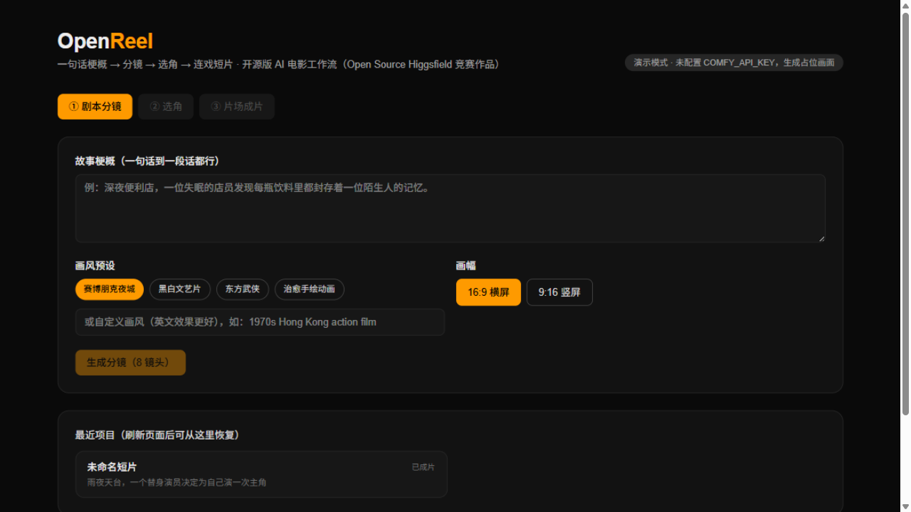
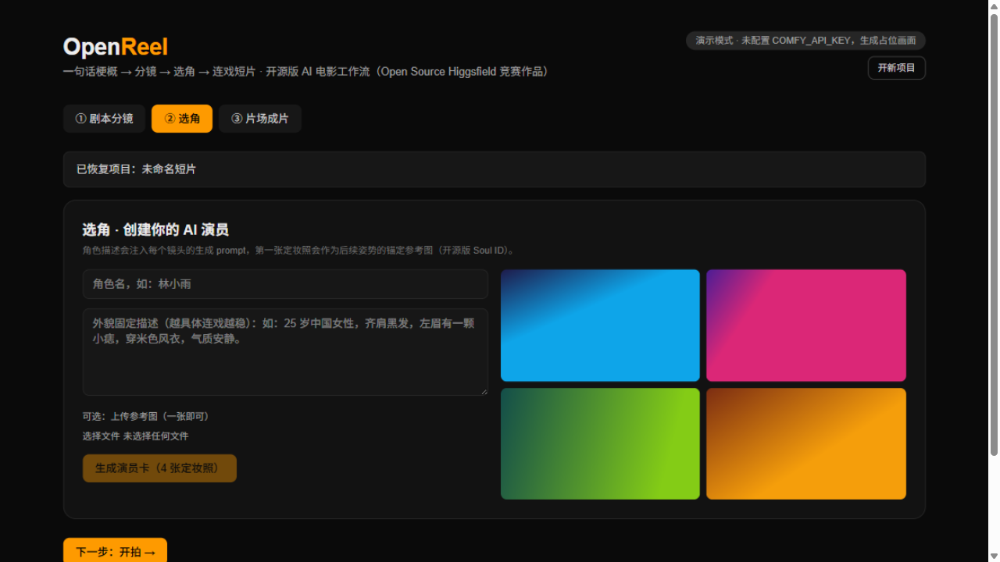
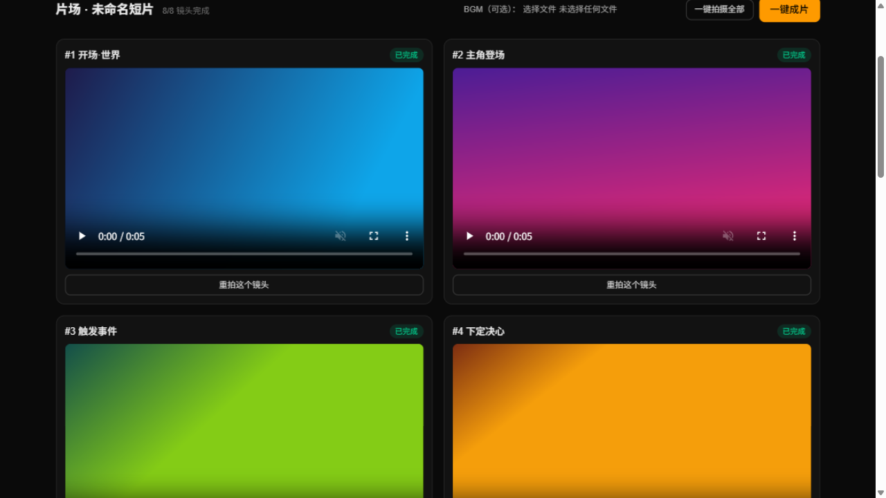

# OpenReel — 开源 AI 短片工作室

> 一句话梗概 → 分镜 → 选角 → 一部角色连戏的短片。
> 为 [Open Source Higgsfield · Comfy](https://comfy.org/open-source-higgsfield) 竞赛构建：
> Higgsfield 用 **Soul Cast**（选角）、**Soul ID**（角色一致性）、**Soul Cinema**（电影感生成）搭了一座
> 闭源的 AI 电影厂；这个项目用 Comfy 生态把同一套管线开源出来。

| 首页与最近项目 | 选角 · 演员卡 | 片场 · 成片 |
| --- | --- | --- |
|  |  |  |

▶ 完整操作录屏见 [demo/openreel-demo.webm](demo/openreel-demo.webm)（演示模式，52 秒）。

## 它是怎么工作的

```
故事梗概 ──► LLM 分镜（8 镜头：画面 / 运镜 / 台词 / 时长，可编辑）
              │
              ▼
        选角 · 演员卡（开源版 Soul ID）
        外貌固定描述 + 统一画风块 + 第一张定妆照作为锚定参考图
              │
              ▼
        每个镜头：演员卡 + 分镜 ──► FLUX 3 关键帧 ──► MiniMax H3 图生视频
              │
              ▼
        ffmpeg 拼装：统一规格 → concat → 烧录台词字幕 → 混入 BGM ──► 成片 MP4
```

角色连戏的三层机制（都在开源代码里，无黑盒）：

1. **文本锚定**：角色外貌描述原文注入每个镜头的关键帧 prompt；
2. **图像锚定**：第一张定妆照作为 `reference_image` 传给后续所有生成；
3. **画风锁定**：统一的 styleBlock（画风预设 + 摄影语言）贯穿全片。

## 快速开始

前置要求：Node 22+、ffmpeg（含 ffprobe，加入 PATH）。

```bash
npm install
cp .env.example .env
npm run dev          # 打开 http://localhost:3000
```

**零配置即可跑通全流程**（演示模式）：未配置任何 Key 时，分镜用内置模板、画面用 ffmpeg
占位图/测试视频，用于开发与演示产品闭环。

### 配置真实生成

在 [.env](.env.example) 中填入：

- `COMFY_API_KEY` — 在 [platform.comfy.org](https://platform.comfy.org) 获取，用于 Comfy Router API；
- `LLM_API_KEY` / `LLM_BASE_URL` / `LLM_MODEL` — 任意 OpenAI 兼容接口（GLM / DeepSeek / OpenAI…），用于分镜。

模型 ID 用内置工具查询有效值：

```bash
npm run models              # 列出全部可用模型（可加关键词：npm run models -- flux）
npm run models <model_id>   # 查看某模型的入参 schema（遇到 422 时对照排查）
```

默认值 `OPENREEL_IMAGE_MODEL=bfl/flux-3-image`、`OPENREEL_VIDEO_MODEL=minimax/minimax-h3`
已按官方 schema 核实（图像入参：`prompt`/`aspect_ratio`/`images`；视频入参：`content`/`duration` 4–15 秒/`resolution` 768P|2K/`ratio`）。

## 目录结构

```
src/lib/comfy.ts      Comfy Router API 客户端（提交/轮询/取结果/媒体下载，已按官方 schema 核实）
src/lib/llm.ts        分镜 LLM（OpenAI 兼容）+ 内置 mock 分镜
src/lib/media.ts      ffmpeg 管线：归一化 → concat → 字幕 → BGM；mock 媒体生成
src/lib/store.ts      文件型项目存储（.data/projects/*.json）
src/app/api/*         REST：storyboard / character / shot / film / project / projects / assets / config
src/components/Studio.tsx   三步向导 UI（剧本 → 选角 → 片场）
workflows/            本地 ComfyUI（Open Weights）路线的起点模板
scripts/list-models.mjs     模型 ID 发现工具
scripts/smoke.mjs           端到端冒烟测试（支持 16:9 / 9:16）
scripts/demo-seed.mjs       一键生成完整演示项目（8 镜头 + 字幕 + 成片）
demo/openreel-demo.webm     操作录屏（演示模式）
docs/SETUP.md         详细配置与排障手册
```

## Open Weights 路线（本地 ComfyUI）

默认的 Router API 路线依赖云端托管模型（FLUX 3、MiniMax H3）。若想参与竞赛的
"Open Weights Only" 赛道，参见 [workflows/README.md](workflows/README.md)：
用本地 ComfyUI + 开源权重（FLUX / Wan）替换 `src/lib/comfy.ts` 的实现即可，产品层无需改动。

## 竞赛映射

| 竞赛奖项 | 本项目的对应点 |
| --- | --- |
| Best Overall | 完整管线：梗概 → 成片，别人拿去就能用自己的故事拍片 |
| Built with FLUX 加成 | FLUX 3 为关键帧与定妆照核心（`OPENREEL_IMAGE_MODEL`） |
| Built with MiniMax H3 加成 | H3 为视频核心（`OPENREEL_VIDEO_MODEL`） |
| Open Weights Only | `workflows/` 本地路线 + 替换 comfy 客户端 |
| 演示模式 | 未配置 Key 也能完整演示产品闭环（ffmpeg 占位媒体） |

## 已知限制（MVP）

- 每镜头 4–6 秒、全片 8 镜头（约 40–60 秒），一键成片按分镜顺序拼接；
- 演示模式的占位画面是 ffmpeg 测试图，不是真实生成；
- Router 各模型的媒体 URL 有 12–24h 签名时效，应用会立即下载到本地 `.data/assets/`；
- 角色一致性依赖 prompt 锚定 + 参考图，跨 8 个镜头可能出现漂移——重拍单个镜头即可。

## License

[MIT](LICENSE)
